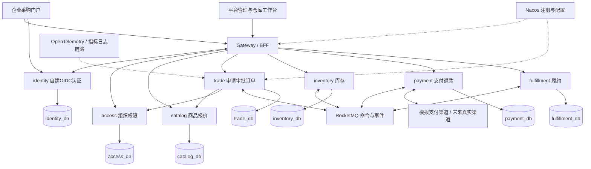

# 04 技术架构与服务边界

版本：v1.1｜状态：设计与应用骨架已落地，业务、协议和压测待实现。版本号以[版本基线](01-版本基线与官方依据.md)为唯一来源。

## 1. 总体决策

项目采用六个业务服务、一个自建identity-service和一个网关，合计八个应用部署单元。identity基于Spring Security 7授权服务器能力提供OIDC，单独承担认证学习目标；多个业务微服务不等于多个SSO系统。对于真正只有一个维护者的小型生产系统，模块化单体往往成本更低；本项目选择微服务是为了练习网络失败、独立数据所有权和部署治理，不应把教学拆分当成普遍最佳实践。

每个业务服务内部使用普通分层：接口、应用用例、领域规则、数据与外部适配。简单商品查询无需套完整领域框架；订单、库存、支付必须有明确状态机。只在真实替换点定义接口，不为每个类再套一层。

## 2. 系统上下文与容器视图



图中Nacos与观测连接为示意，实际覆盖全部服务。Gateway无业务数据库，Redis保存BFF会话；每个服务只访问自己的数据库账号。开发可共用MySQL实例的不同库；生产物理隔离按容量与风险决定。

## 3. 服务职责与边界

| 服务 | 拥有的数据与规则 | 不承担的职责 | 主要依赖 |
|---|---|---|---|
| identity-service | 全局账号、凭据、OIDC客户端、授权记录、Token签发、身份会话、密钥生命周期 | 企业成员角色、采购审批、手写OAuth/OIDC协议处理器 | identity_db、Redis、受控密钥文件 |
| access-service | 企业、成员、角色、审批人设置、权限决策、受控支持授权 | 密码登录和Token签发、订单审批状态 | OIDC身份标识 |
| catalog-service | 平台分类、SPU/SKU、价格版本、可售规则、报价快照来源 | 可承诺库存、订单状态 | 自有数据库 |
| trade-service | 申请、审批、订单快照、编排任务、取消和退款意图、站内待办 | 直接扣库存、判定渠道到账、实际发货 | access、catalog、MQ |
| inventory-service | 平台仓库库存、预占/分配/释放/出库、库存流水 | 商品价格、付款真实性、买家私有库存 | MQ |
| payment-service | 支付意图与尝试、回调、渠道查询、退款、资金对账 | 网页跳转判付成功、修改订单表 | 模拟渠道、MQ |
| fulfillment-service | 履约单、发货资格、退款冻结、物流单号、发货事实 | 款项确认、商品定价 | MQ |
| gateway | 路由、BFF会话、OIDC Client登录、边缘限流、请求关联 | Token签发、下单编排、SQL查询、跨库聚合业务 | identity、Redis、服务发现 |

申请与审批留在交易服务，保证批准与成单意图本地原子写入。通知首版复用交易待办和时间线，不另拆一个没有独立规模的通知服务。收货由交易服务校验订单并记录；物流轨迹、签收回调以后由履约服务拥有。

## 4. 技术选型与使用理由

| 层面 | 选择 | 约束与替代触发条件 |
|---|---|---|
| Java基线 | JDK21；SCA2025.1.0.0 | Boot4.0.8 + Cloud2025.1.3为待验证补丁候选，禁止称已联调 |
| 网关 | Spring Cloud Gateway WebFlux + Spring Security OAuth2 Client | 使用Boot4适用的依赖坐标，按POC核对；网关不放阻塞SQL |
| 业务Web | Spring MVC + Jakarta Validation | 不因网关用WebFlux就把全部业务改响应式 |
| 数据访问 | Spring Data JPA/Hibernate、HikariCP | 业务Repository使用JPA；库存和状态转移显式条件更新、版本与行数检查；框架认证仓储复用JDBC实现 |
| 迁移 | Flyway与对应数据库模块 | 随Boot兼容依赖管理；禁止ORM自动改生产结构 |
| 数据库 | MySQL8.4 LTS系列候选，补丁需冻结 | 一个服务一个逻辑库、一个账号，不共享表 |
| 注册配置 | Nacos | 采用spring.config.import；配置与注册权限分别控制 |
| 消息 | RocketMQ，与SCA模块支持的Remoting接入方式一致 | 首轮单一接入方式，不同时套Stream和原生SDK两种封装 |
| 流控 | Sentinel | 核实Gateway适配；规则经审核持久化，不能只在Dashboard点按钮 |
| 会话缓存 | Redis | BFF会话、低风险缓存、限流；金额和库存以数据库为准 |
| 身份 | 自建identity-service，Spring Security 7 Authorization Server + OIDC | 单采购门户Code+PKCE；业务服务使用Resource Server；不部署Keycloak或Sa-Token；精确版本由Boot管理 |
| 可观测 | Micrometer指标、OpenTelemetry链路、结构化日志 | 开发按需启用Prometheus/Grafana/Tempo/Loki，避免全栈常驻占满内存 |
| 前端 | 一个Vue3 + TypeScript门户，按角色显示菜单 | 版本在前端开工时核验冻结；本次未声称已验证其生态组合 |
| 构建部署 | 本地Maven3.9.9/JDK21、容器、Compose | 不使用Wrapper；Kubernetes作为后续学习，不阻塞核心闭环 |

**不默认加入**Dubbo、Kafka、Elasticsearch、ShardingSphere、工作流引擎、服务网格、分布式锁框架或XXL-JOB。当前数据库任务轮询足够处理超时和补偿，多实例使用数据库任务租约。存在测量证据后再引入新组件。

## 5. 调用规范

同步用于权限校验、报价和读接口；异步用于库存预占、资金确认、履约、补偿与恢复。同步HTTP优先采用当前Spring代际支持的客户端，不为“微服务标配”强行使用旧教程的Ribbon/Hystrix。

内部调用必须带可验证的服务身份。用户委托动作还要带有效用户上下文并重新校验企业归属；异步任务使用创建时确认的业务单据和执行时必要授权，不把过期用户Token塞进消息长期重放。

初始超时预算为网关3秒、同步聚合总预算2秒、单次内部调用约800毫秒（连接约200毫秒）；由压测校准。支付发起只返回异步处理中，不同步等渠道最终结果。只有已知幂等的读操作可在预算内重试一次；写请求经唯一业务键重试，不能堆叠SDK、网关和服务三层自动重试。

依赖失效时：商品列表允许返回带时间戳的旧缓存，标明库存参考；报价和下单失败关闭；access高危写权限校验失败关闭；Redis会话失效要求重新登录；MQ故障时已持久化命令继续显示处理中，并受积压阈值限制新写入。

## 6. 代码组织建议

```text
cloud-project/
  docs/                         # 产品、需求与架构基线
  pom.xml                       # 未来根聚合与依赖锁定
  gateway/                      # BFF与边缘接入
  services/
    identity-service/           # 账号、OIDC授权服务器和密钥生命周期
    access-service/             # 企业和授权
    catalog-service/            # 商品报价
    trade-service/              # 申请审批订单与流程任务
    inventory-service/          # 库存账和预占
    payment-service/            # 渠道适配与对账
    fulfillment-service/        # 冻结与发货
  frontend/                     # 同一应用的买家和平台角色界面
  contracts/                    # OpenAPI与事件Schema，非共享实体包
  deploy/                       # Compose、配置模板和以后部署清单
  tests/                        # 跨服务验收与故障场景
```

当前已创建根pom、gateway、七个services应用和deploy基础配置；frontend、contracts及跨服务tests目录随对应实现创建，不生成空目录。服务只共享经版本化的契约、基础日志约定，不共享ORM实体、Repository或大而全的common业务包。业务代码需中文注释解释非显然的状态约束、金额和并发原因；不用逐行复述代码。

identity与access通过稳定subject_id关联，不共享账号表；identity不持有企业财务角色，access不存密码。认证流程和服务身份规则见[认证详细设计](13-自建OIDC认证服务设计.md)，JPA使用边界见[数据设计](05-领域模型与数据设计.md)。

## 7. 架构检查清单

新增一个用例，先问：哪个服务持有事实？谁可以修改？失败时谁恢复？用户看到什么？如何追踪？如果答案是“大家都改订单表”或“加一个分布式锁就好”，边界还没设计完。
