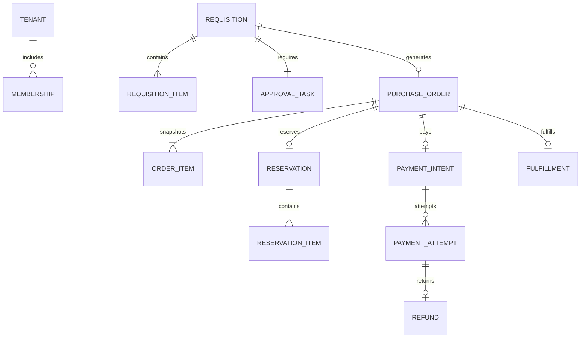

# 05 领域模型与数据设计

版本：v1.1｜业务持久化采用Spring Data JPA/Hibernate。这是逻辑数据模型与建表约束，不是已经执行的DDL。实施时需补全类型、命名、迁移与Explain验证。

## 1. 统一语言与所有权

| 名词 | 精确定义 | 所有者 |
|---|---|---|
| 租户 Tenant | 一家买方企业；不是供应商，也不是平台仓库 | access |
| 商品 SKU | 可报价和履约的最小规格 | catalog |
| 申请 Requisition | 用户提交的采购快照与用途，需要批准 | trade |
| 订单 Order | 批准后生成、受库存和付款约束的购买承诺 | trade |
| 预占 Reservation | 为订单暂留的数量，禁止其他订单使用 | inventory |
| 分配 Allocated | 已付款且为该订单保留，等待出库的库存 | inventory |
| 支付意图 PaymentIntent | 一次订单付款授权与金额，具有关闭栅栏 | payment |
| 支付尝试 PaymentAttempt | 意图下的一次渠道执行，未知时禁止开启下一次 | payment |
| 退款 Refund | 对一笔成功支付的全额原路返还 | payment |
| 履约单 Fulfillment | 是否允许发货、是否冻结和实际发货的事实 | fulfillment |

同一个名词不能同时表示申请、订单和支付单。库存是平台全局商品资产，不按买方tenant_id复制；其预占单保存买方归属，用于授权核查与追踪。平台商品和仓库表不是缺少租户过滤的漏洞，企业私有单据才必须隔离。

## 2. 聚合关系

跨服务连线是逻辑ID关联，不创建跨库外键。单服务内可以使用必要外键与检查约束，删除行为明确禁止级联抹除账务历史。

## 3. 通用数据约定

- 主键使用服务端UUID（接口字符串），业务展示编号另设唯一索引；避免为发号服务新增部署组件。高体量时再评估UUID索引成本，当前用UUID存储形式与索引实验决定。
- 所有金额使用有符号BIGINT整数分并验证非负与上限，币种固定CNY；禁止double。报价由单价分×整数数量求和，每一步检查溢出和业务上限。
- 时间内部保存UTC毫秒精度，接口ISO8601带偏移，界面Asia/Shanghai；超时以服务器时钟为准。
- 可变聚合有version；条件更新必须校验旧状态/版本与受影响行数。账务、流水和审批记录不以普通编辑覆盖。
- 企业私有表带tenant_id；默认查询、唯一约束、索引和引用校验包含租户。无tenant_id的子表只允许经已鉴权父单加载；建议订单子表也显式带tenant_id便于防御与审计。
- 不存银行卡、渠道密钥或明文密码。收货地址、姓名、手机号是个人信息，只存必要快照，读出脱敏。

## 4. 逻辑表清单

| 库/表 | 关键字段 | 唯一性、索引与规则 |
|---|---|---|
| identity.user_account | subject_id、login_name_normalized、password_hash、status、credential_version、version | 登录名规范化后唯一；全局账号不带买家tenant_id；subject不可回收复用 |
| identity.account_action_token | token_hash、subject_id、purpose、expires_at、consumed_at | 仅存一次性激活/重置凭据哈希，过期或消费后不得重放 |
| identity.mfa_credential | subject_id、encrypted_totp_secret、enabled_at | P1启用；恢复码单独存哈希，敏感字段加密 |
| identity.lifecycle_task | subject_id、credential_version、action、state、attempts、next_run_at、lease_token | 账号停用/重置后的授权与会话清理任务，幂等重试，不能直接删除失败记录 |
| identity.oauth2_registered_client | 按冻结Security版本官方Schema | 框架JDBC仓储，固定门户客户端及必要服务身份；Secret安全编码 |
| identity.oauth2_authorization | 按冻结Security版本官方Schema | 框架JDBC仓储；授权码/Token等敏感列限制访问，不共享给业务服务 |
| identity.oauth2_authorization_consent | 按冻结Security版本官方Schema | 框架JDBC仓储，升级Schema走Flyway，不自创JPA等价实体 |
| access.tenant | id、name、status、version | 企业停用后阻止新写入，已付款履约转受控处理 |
| access.membership | tenant_id、subject_id、status、authz_version | UNIQUE(tenant_id,subject_id) |
| access.role_binding | tenant_id、subject_id、role、scope | 绑定唯一；管理员不能默认取得全部资金权限 |
| access.approval_setting | tenant_id、approver_subject、version | 单级审批，配置更改不回写旧申请 |
| access.support_grant | tenant_id、operator、ticket_id、expires_at、scope | 限时企业授权，强审计 |
| catalog.spu/category | id、name、status | 平台资源，非企业私有 |
| catalog.sku | id、spu_id、spec、sale_status、price_minor、price_version | price_version并发保护；SKU不可被普通硬删除 |
| catalog.price_history | sku_id、version、price_minor、effective_at | UNIQUE(sku_id,version)，可追溯 |
| trade.requisition | id、tenant_id、creator、approver、state、expires_at、total_minor、address_snapshot、version | (tenant_id,creator,created_at,id)、(state,expires_at) |
| trade.requisition_item | tenant_id、request_id、sku_id、name/spec/price快照、qty | UNIQUE(request_id,sku_id)，重复SKU提交前合并 |
| trade.approval_task | tenant_id、request_id、assignee、decision、reason、acted_at、version | UNIQUE(request_id)，更新仅限PENDING；重分派记录原人与新人的审计 |
| trade.purchase_order | tenant_id、request_id、state、total_minor、pay_deadline、payment_fence、version | UNIQUE(tenant_id,request_id)；(tenant_id,state,created_at,id) |
| trade.order_item | tenant_id、order_id、sku_id、快照、qty、subtotal_minor | UNIQUE(order_id,sku_id) |
| trade.workflow_task | tenant_id、order_id、step、status、attempts、next_run_at、lease_until、lease_token | UNIQUE(order_id,step)，到期扫描索引 |
| trade.order_timeline | tenant_id、order_id、event_id、from/to、reason、time | UNIQUE(order_id,event_id)，只追加 |
| inventory.stock | warehouse_id、sku_id、on_hand、reserved、allocated、version | UNIQUE(warehouse_id,sku_id)；计数均≥0，on_hand≥reserved+allocated |
| inventory.reservation | order_id、buyer_tenant_id、state、order_version | UNIQUE(order_id)；即使未预占也可保存RELEASED墓碑 |
| inventory.reservation_item | order_id、warehouse_id、sku_id、qty | UNIQUE(order_id,warehouse_id,sku_id) |
| inventory.stock_ledger | operation_id、order_id、sku_id、type、qty、before/after、reason | UNIQUE(operation_id,sku_id,type)，只追加 |
| payment.payment_intent | order_id、buyer_tenant_id、amount_minor、currency、state、fence | UNIQUE(order_id)，关闭后不能晚到创建重新打开 |
| payment.payment_attempt | intent_id、attempt_no、state、channel_ref、amount_minor | UNIQUE(intent_id,attempt_no)、UNIQUE(channel,channel_ref)；channel_ref允许未分配 |
| payment.channel_callback | channel、channel_event_id、body_hash、verified、received_at | UNIQUE(channel,channel_event_id)，加密/脱敏保留必要原始凭证 |
| payment.refund | payment_id、order_id、refund_no、amount_minor、state | UNIQUE(order_id)、UNIQUE(refund_no)，首版每单一次全额退款 |
| payment.reconciliation | batch_id、order_id、diff_type、state、owner | 同批次同差异唯一，跟踪处理结果 |
| fulfillment.fulfillment | order_id、buyer_tenant_id、state、address_snapshot、tracking_no、version | UNIQUE(order_id)，READY/FROZEN/SHIPPED/CLOSED |
| 各服务.outbox | event_id、aggregate_id、aggregate_version、type、schema_version、payload、state、attempts、next_run_at、lease_token | PK(event_id)、(state,next_run_at)，业务写与本表同事务 |
| 各消费服务.inbox | consumer_name、event_id、processed_at | UNIQUE(consumer_name,event_id)，与消费业务同事务 |
| 各服务.idempotency_record | tenant_or_platform_scope、actor、operation、key_hash、request_hash、result_ref、state、expires_at | 作用域四元组唯一，响应不得跨用户复用 |
| 各服务.audit_log | actor、tenant/platform_scope、action、resource_id、result、trace_id、before/after脱敏、created_at | 只追加、访问受控；生产外送独立审计存储 |

普通审计不等于资金流水。库存账、支付账是业务事实，不能由运维清理审计脚本删除。

## 5. 库存计算与原子性

可售量 = on_hand − reserved − allocated。

| 操作 | 库存计数变化 | 预占状态 |
|---|---|---|
| 预占q | reserved += q，要求可售量≥q | RESERVED |
| 付款后分配q | reserved -= q，allocated += q | ALLOCATED |
| 取消预占q | reserved -= q | RELEASED |
| 发货前退款释放q | allocated -= q | RELEASED |
| 发货q | allocated -= q，on_hand -= q | SHIPPED |
| 入库q | on_hand += q | 不改变预占 |

一个订单多SKU按稳定SKU顺序加锁，全部校验和更新在inventory本地一个事务完成；任一不足则整单回滚。MVP不做部分成功。库存在渠道支付成功后不会自动变可售；必须由编排确认退款/取消且履约冻结后释放。

释放早于预占到达时保存RELEASED墓碑；迟到预占不能重新占用。已SHIPPED的预占不可释放。盘点调整必须保证调整后on_hand≥reserved+allocated，不允许靠直接覆盖on_hand掩盖差异。

## 6. 快照、查询与归档

提交申请时冻结报价，批准后沿用该报价；订单包含名称、规格、单价、数量、地址、审批来源和参数快照。当前商品变化不能影响历史金额，当前成员昵称变化不抹除操作者身份。

分页默认20、最大100；固定created_at与id倒序，深页采用游标。跨服务报表首版基于明确标注延迟的只读投影，不做线上跨库JOIN。投影可重建，不反向写主表。

开发建议保留：API幂等响应7天；已发送Outbox、Inbox至少30天且大于最大重放窗口；重放超过窗口前须依赖业务永久唯一键去重并专项评审。未完成任务、未知付款、对账差异和预占墓碑不能被定时清理。关闭单据的墓碑必须覆盖所有可能的迟到命令；无法证明最大时延时随业务历史长期保留。

历史订单与资金流水生产保留期限需由业务与合规确认，本文不预设法定年限。所有开发种子只使用合成数据。数据库备份必须包含状态、Outbox、Inbox与任务表，恢复后再执行跨服务对账。

## 7. JPA实现约束

业务使用Boot管理版本的JPA Starter与Hibernate，JDBC是其底层访问机制。identity的业务账号使用JPA，协议表复用框架JDBC仓储。两者均由Flyway迁移；协议Schema取自冻结依赖版本，不从旧博客复制。

可变聚合普通实体更新采用`@Version`；库存和状态迁移可使用`@Modifying`配合显式JPQL/原生SQL，实现数量/旧状态/版本条件与受影响行数校验。批量更新不会自动获得普通实体的全部乐观锁行为，必须显式维护version并处理持久化上下文的陈旧数据；按用例确定flush/clear顺序，不能无条件clear丢弃待提交修改。参见[官方修改查询说明](https://docs.spring.io/spring-data/jpa/reference/jpa/query-methods.html)。

库存多行操作、流水、Inbox和Outbox仍在同一应用用例的本地事务完成。禁止依赖“先查数量、Java减法、save”保证并发安全，禁止远程HTTP/MQ等待期间长期持有数据库锁。死锁重试必须重跑完整且幂等的本地用例。

实体只在服务内部使用：跨服务只存ID与快照，禁止跨库`@ManyToOne`；API使用DTO，避免实体懒加载和敏感字段泄露。关闭Open Session in View；查询按用例使用投影、fetch join或明确加载计划，检查N+1与分页SQL。不得用集合fetch join隐式内存分页承载订单列表。

应用启动使用schema校验而非`ddl-auto=update/create`；审计、库存流水、唯一约束不能只依赖实体注解，必须落实到迁移SQL。JPA不自动提供租户隔离，所有Repository与原生查询仍按归属规则实现和测试。
