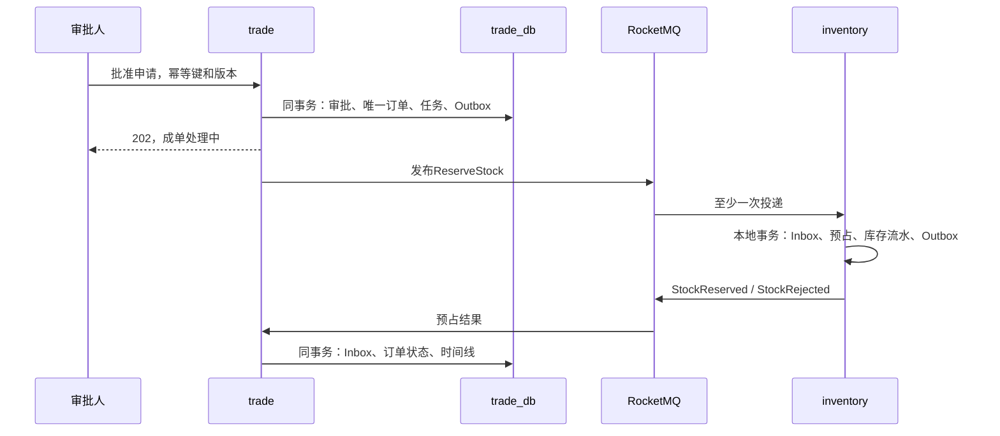

# 07 核心流程、状态机与一致性

版本：v1.0｜本项目最重要的设计约束。关联：[数据](05-领域模型与数据设计.md)、[契约](06-接口与事件契约.md)、[测试](10-测试与质量门禁.md)。

## 1. 必须始终成立的不变量

1. 一份已批准申请最多生成一个订单；订单金额等于批准快照金额。
2. 库存可售量不为负；同订单预占、分配、释放和出库每种效果最多一次。
3. 一个订单只有一个支付意图，任何时刻最多一个未决渠道尝试；首版只允许一笔生效整单支付及一次全额退款。
4. 未确认付款及库存分配不能授权发货；履约单只有READY可发货。
5. 退款渠道请求必须发生在履约冻结确认之后；已发货不能走自动退款。
6. 任何网络超时都表示结果未知，不能据此反向记账。
7. 业务事实与待发布事件在同一服务的一个本地事务内提交；消费去重与业务效果也同事务。
8. CANCELLED、REFUNDED、COMPLETED及STOCK_FAILED为各自流程的终态；不能通过重复消息回退。已关闭后收到真实付款必须启动退款，不丢弃资金事实。

## 2. 状态模型

申请：DRAFT → PENDING_APPROVAL → APPROVED / REJECTED / WITHDRAWN / EXPIRED。只有批准可以启动成单；APPROVED保持审批事实，通过独立orderCreationStatus显示PROCESSING/SUCCEEDED/STOCK_REJECTED/EXCEPTION，不把已经批准改成“未批准”。

| 订单状态 | 含义 | 可到达的主要状态 |
|---|---|---|
| STOCK_PENDING | 订单已建，等预占 | WAITING_PAYMENT / CANCELLING / STOCK_FAILED / EXCEPTION |
| STOCK_FAILED | 确定缺货/禁售，成单失败终态 | 不复用原单重开，修改申请重新批准 |
| WAITING_PAYMENT | 库存预占成功，付款窗口内 | PAYMENT_VERIFYING / CANCELLING |
| PAYMENT_VERIFYING | 已建立支付栅栏，等待确认付款或关闭 | PAID_STOCK_PENDING / CANCELLING / WAITING_PAYMENT / EXCEPTION |
| PAID_STOCK_PENDING | 付款确认，等库存转分配 | READY_TO_SHIP / REFUND_FREEZING / EXCEPTION |
| READY_TO_SHIP | 付款、库存和履约资格均已确认 | SHIPPED / REFUND_FREEZING |
| SHIPPED | 仓库确认已发货 | COMPLETED |
| COMPLETED | 用户确认收货 | 终态 |
| CANCELLING | 关闭付款与释放库存中 | CANCELLED / PAID_STOCK_PENDING / EXCEPTION |
| CANCELLED | 付款关闭且库存释放已确认 | 终态；晚到真实付款走异常退款子流程 |
| REFUND_FREEZING | 正在确认履约冻结 | REFUNDING / READY_TO_SHIP / SHIPPED / EXCEPTION |
| REFUNDING | 冻结成功，渠道退款中 | REFUND_RELEASE_PENDING / READY_TO_SHIP / PAID_STOCK_PENDING / EXCEPTION |
| REFUND_RELEASE_PENDING | 渠道确认退款，等库存释放与履约关闭 | REFUNDED / EXCEPTION |
| REFUNDED | 退款成功，库存及履约已收尾 | 终态 |
| EXCEPTION | 无法自动确定下一步，需要核对 | 按保存的lastSafeState和事实继续编排，禁止任意跳状态 |

状态是交易服务对流程的视图，不替代payment的资金事实与fulfillment的发货事实。EXCEPTION必须带错误原因、最后安全状态、待确认动作及责任人，不能成为掩盖错误的垃圾桶。

支付尝试：CREATED → PENDING/UNKNOWN → SUCCEEDED / CLOSED / FAILED。只有渠道明确未成功且不可再成功才能记CLOSED/FAILED；UNKNOWN不是终态。退款：REQUESTED → PENDING/UNKNOWN → SUCCEEDED / FAILED。履约：READY → SHIPPED 或 FROZEN；FROZEN → CLOSED或经确定退款失败解冻为READY。

## 3. 下单与库存预占

trade在发ReserveStock前复核catalog可售状态，但保留审批价格。明确禁售在尚未发送预占时进入STOCK_FAILED；复核网络失败保留STOCK_PENDING重试。复核通过后普通下架不撤销本次承诺，安全召回另行冻结。

库存持有唯一orderId预占头，多行SKU按顺序校验与更新，全单原子。收到重复ReserveStock返回已有结果。若已存在RELEASED墓碑，不重新预占。缺货是业务失败，网络超时保留STOCK_PENDING并重试/查询，不能认为预占没发生。技术未知时不能进入STOCK_FAILED，否则可能遗留已成功的预占。

预占成功后由trade基于事务时间确定payDeadline并保存，库存不会靠本地TTL擅自释放。trade到期任务通过支付关闭协议和释放命令收尾；进程停机时订单可能超期占库，但恢复后可处理，优先保证不超卖。

## 4. 支付与超时取消的竞争

付款入口在trade。对WAITING_PAYMENT执行条件更新，建立不可变paymentFence，转PAYMENT_VERIFYING并写OpenPaymentIntent。支付服务以orderId唯一建立支付意图，使用渠道可识别的唯一商户请求号；相同命令重试查询/复用同一次尝试。

超时或用户取消不能直接释放库存。trade先转CANCELLING并发ClosePaymentIntent，payment关闭渠道或查询结果：

| payment确认结果 | trade动作 |
|---|---|
| 从未创建且不存在可执行尝试 | 持久化CLOSED墓碑，拒绝迟到Open，回复PaymentClosed |
| 渠道已明确关闭/失败且不可能成功 | 回复PaymentClosed，trade发ReleaseStock |
| 渠道已成功 | 回复PaymentSucceeded，trade接受付款并继续库存分配；用户再走退款 |
| 渠道未知、超时、无法证明已关闭 | 保持核验/取消中，禁止释放库存，查询与告警 |

Open与Close在payment以同一orderId本地锁与状态机串行。建立尝试、关闭标志和待执行渠道任务在数据库保存；调用渠道时不持有跨网络数据库长事务。外部任务执行前后都核对栅栏；关闭逻辑必须处理“创建渠道请求已经发出但响应尚未回来”。对这种在途尝试不能因本地未成功就确认关闭。

确定失败、窗口仍有效时可回WAITING_PAYMENT，由用户发起下一attemptNo；上一次UNKNOWN时不能开新尝试。收到成功回调后金额、币种、商户、单号必须与意图一致。

正常成功：payment写SUCCEEDED和Outbox → trade接收确认付款 → CommitStock → inventory将RESERVED转ALLOCATED → trade发AuthorizeFulfillment → fulfillment创建READY → trade收到FulfillmentReady进入READY_TO_SHIP。

如果支付成功但库存分配遇技术失败，订单停在PAID_STOCK_PENDING并重试。若发现预占已丢失等不可恢复差异，冻结履约并启动全额退款/人工核对，不能直接改成缺货失败吞掉付款。

晚到成功与CANCELLED冲突时，payment仍保存真实成功款项；trade创建独立异常退款子流程，订单保持关闭事实，并展示“关闭后收款，退款处理中”。该子流程先冻结/关闭履约（即便尚未创建也存墓碑），再原路退款；不把晚到付款重新发货。

## 5. 发货与退款竞争

退款不是先调用渠道再通知仓库。trade进入REFUND_FREEZING后发FreezeFulfillment；fulfillment执行`READY → FROZEN`与仓库执行`READY → SHIPPED`竞争同一行版本，只有一个成功。

- 冻结成功：创建退款；仓库发货被拒绝。若履约授权尚未到，先创建FROZEN墓碑，后来的AuthorizeFulfillment不能把它改READY。
- 发货先成功：返回AlreadyShipped，trade采纳SHIPPED事实并拒绝自动退款，进入首版人工售后边界。
- 冻结请求超时：保持REFUND_FREEZING，不能发退款。以相同refundRequestId查询/重试。
- 渠道退款成功：写资金事实 → trade转REFUND_RELEASE_PENDING → 关闭履约、释放预占/已分配库存 → 收齐确认转REFUNDED。
- 渠道明确退款失败：记录失败并根据仍有效的付款与库存事实恢复退款前的安全状态；只有确认库存ALLOCATED才能解冻到READY，否则继续PAID_STOCK_PENDING编排。若需新退款尝试复用同refundNo，查询渠道确认可安全重试，不创建第二笔全额退款。
- 退款未知：保持FROZEN并告警对账，不解冻、不释放库存、不允许发货。

库存实际出库由ShipmentDispatched驱动。即使消息延迟，fulfillment已SHIPPED也会阻止退款冻结；trade不允许绕过冻结直接释放库存，因此不会将已发出的实物重新计为可售。

## 6. Outbox、Inbox与任务恢复

业务事务同时写Outbox。发布器批量领取到期记录，使用lease_token与过期时间；broker确认后以相同token标记已发送。发成功但更新数据库前宕机会重复投递，因此消费端把Inbox插入、状态变化、后续Outbox写入放在同一事务。业务唯一约束是长期底线，Inbox不能替代它。

初始轮询间隔500毫秒、每批100、租约30秒；这些是待压测参数。失败指数退避并加抖动，达到10次或最老待发超过60秒立即告警；失败记录进入可见隔离队列后仍保留修复和重放义务，不能“重试耗尽就算结束”。

任务表保存step、nextRunAt、attempts和leaseToken。多实例不能靠JVM定时器互斥；使用数据库条件领取。旧执行者租约过期后不能以旧token覆盖新结果。外部渠道执行可能已发生，必须再靠渠道幂等号与查单保证安全。

跨服务事件不假定全局顺序。释放早于预占、冻结早于授权、关闭早于付款创建均需要墓碑；成功款项晚于取消需要异常退款。高版本不适用事件进入核对而不是静默丢弃。

## 7. 对账与人工处理

支付服务每分钟扫描超过2分钟未决尝试，按渠道查询；trade每分钟扫描超过30秒未推进任务；库存周期扫描超期预占并请求trade确认，不自行释放。每日形成订单、渠道支付、退款与库存履约差异报告，模拟渠道提供可重复账单数据。

差异至少分类：渠道成功订单未付、订单已付渠道未确认、重复资金、金额不符、已取消仍占库、已退款仍分配、已发货未出库。低风险技术失败自动重试；金额不符和多笔资金必须人工复核，不能用通用“强制成功”按钮处理。

人工流程：异常单→负责人→核实证据→选择已有补偿动作→高风险复核→执行→重新对账→关闭。所有人工动作有原因、工单、身份和审计。MVP模拟环境可用单人演示复核流程，真实资金生产不得用这个简化替代职责分离。

## 8. 为什么Seata不是这条主线的总开关

本项目把库存短事务与外部支付、物流的长生命周期分开。Seata AT有数据库和SQL等适用边界，不能回滚已经发生的外部渠道扣款或实际发货；参见[Seata AT官方说明](https://seata.apache.org/docs/user/mode/at/)。RocketMQ事务消息解决的也是特定生产事务与消息提交问题，不能自动让所有业务完成，参见[事务消息官方说明](https://rocketmq.apache.org/docs/featureBehavior/04transactionmessage/)。

因此主线采用显式补偿；Seata实验用隔离数据库、模拟余额和模拟库存比较AT/TCC的锁冲突、超时和补偿行为，不接真实渠道，不与主线同一笔业务重复协调。
