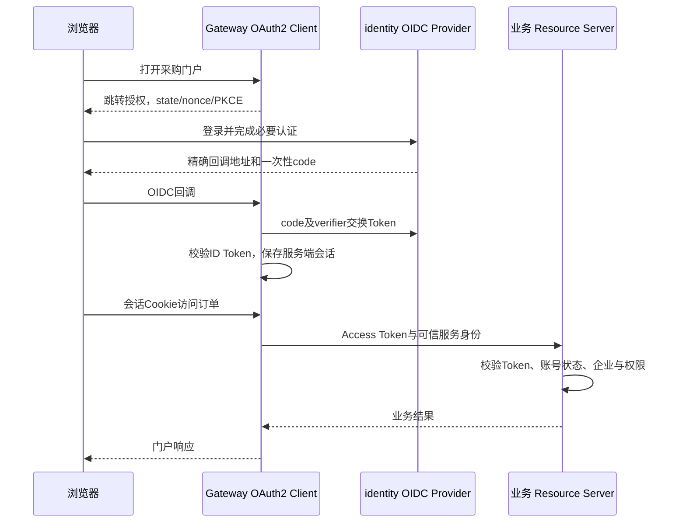

# 13 自建OIDC认证服务设计

版本：v1.1｜2026-10-20｜设计已采纳，代码与兼容性尚未验证。关联：[安全](08-安全与多租户设计.md)、[数据](05-领域模型与数据设计.md)、[测试](10-测试与质量门禁.md)。

## 1. 为什么自建、做到哪里

本项目只有一个采购门户，平台工作台与企业采购页面是同一客户端的角色视图。多个微服务不是多个SSO系统；使用OIDC是明确的标准认证学习目标，不是当前业务强制需要SSO。

自建指基于Spring Security 7的授权服务器能力开发identity-service，账号与业务规则由自己实现，授权码、Token、发现等协议处理复用框架。Spring Authorization Server已并入Security 7，版本随Boot管理；不同时部署Keycloak或Sa-Token，不从零手写OAuth/OIDC处理器。依据：[官方说明](https://spring.io/blog/2025/09/11/spring-authorization-server-moving-to-spring-security-7-0/)、[7.0入门](https://docs.spring.io/spring-security/reference/7.0/servlet/oauth2/authorization-server/getting-started.html)。

首版做本地账号、单门户固定客户端、Authorization Code + PKCE S256、刷新、发现/JWKS、UserInfo、退出、持久化密钥、账号停用与必要服务身份。P1增加平台高权限TOTP。暂不做社交登录、动态客户端注册、外部应用开放授权、第二SSO系统、设备授权或自助邮件找回密码。协议支持范围以端到端测试为准，不声称取得OIDC认证。

## 2. 四方职责

| 组件 | 职责 | 数据所有权 |
|---|---|---|
| identity-service | 用户身份、密码、账号状态、授权服务器、MFA | identity_db、身份会话、签名密钥 |
| Gateway/BFF | OIDC Client、登录跳转/回调、保存Token、刷新、门户会话 | 独立Redis会话命名空间 |
| 业务服务 | Resource Server校验Access Token；资源操作授权 | 各自业务库 |
| access-service | 企业、成员资格、角色、数据范围 | access_db；引用稳定subject_id，不存密码 |

identity登录不调用access，避免认证循环。identity账号存在不等于已加入企业；无企业成员的账号登录后只能看到等待邀请/无访问权页面。企业管理员只能管理本企业成员，不能全局停用一个同时属于其他企业的账号；全局账号运维使用单独的identity-admin权限。

## 3. 最小登录链路

门户是固定机密客户端，client secret仅在BFF保存，仍启用PKCE。浏览器不保存Access/Refresh Token；只保存Secure、HttpOnly会话Cookie。登录和回调保存并验证state、nonce、verifier；使用精确redirect与post-logout redirect白名单，回跳路径只允许站内白名单。

门户Cookie与identity Cookie使用不同名称、主机/路径边界和Redis命名空间；Cookie不按端口隔离，不能在同一localhost下仅换端口就认为两个JSESSIONID不会冲突。推荐本地固定门户与认证主机名，通过本地HTTPS和统一解析同时服务浏览器及容器。

## 4. 账号与凭据生命周期

首个identity-admin通过一次性本地初始化任务创建，密码来自受控输入/Secret，禁止公开固定管理员密码。初始买家账号和成员可用合成种子分两步幂等创建，identity生成subject后由access绑定企业；不创建跨库事务或共享用户表。

邀请已有账号时access直接建立待接受成员邀请；新账号通过受控identity初始化动作生成高熵一次性激活凭据，只存哈希，候选有效期30分钟，使用后原子标记已消费。MVP邀请链接由管理员在本地演示交付，不接邮件短信。身份账号创建成功但成员绑定失败可重试绑定，未绑定账号不获得业务权限。

密码采用维护良好的PasswordEncoder（首轮BCrypt，成本参数经硬件测量），不使用MD5/SHA直接哈希，不存明文。初始化/修改/重置统一密码策略，BCrypt按UTF-8字节限制不超过72字节，长度下限12字符，拒绝明显弱口令。错误登录统一提示以减少账号枚举；账号与来源同时限速，禁止永久锁定被他人恶意触发。改密要求当前密码或受控重置凭据，动作记录审计。

停用账号/重置密码先持久化状态并递增credential_version，再撤销该用户授权、清理身份会话；清理失败保留持久化重试任务。用户授权记录、身份会话与Access Token保存认证时的凭据版本，登录后授权/刷新及高危业务写均核对当前版本；清理未完成时也不能用旧刷新凭据换出新版本Token。重新启用账号不会恢复原凭据。企业成员停用只在access执行，不误伤其他企业成员资格。以上版本检查是需要实现和测试的应用扩展，不宣称框架自动提供。

平台高权限P1启用TOTP，密钥加密、恢复码只存哈希、使用一次即失效，限制重试并防同时间步重放。高危平台动作检查本次认证强度；权限变化或MFA尚未完成时强制补充认证，不能凭历史低强度会话升级。相关加密密钥独立配置，不入Git和Nacos明文。

## 5. Token、会话与服务身份

| 对象 | 初始候选策略 | 校验与用途 |
|---|---|---|
| Authorization Code | 60秒、一次性、绑定client/redirect/verifier | 只给BFF换Token，重放失败 |
| ID Token | 短期签名，aud为门户client_id | BFF校验issuer/aud/nonce/时效；禁止作为业务API凭据 |
| 用户Access Token | 签名JWT，5分钟，aud=cloudprocure-api | 代表本采购平台逻辑API，包含稳定sub、credential_version、授权scope与用户类型；不放可长期信赖的企业角色快照 |
| 服务Access Token | Client Credentials，5分钟，aud=cloudprocure-internal | 绑定唯一服务client和最小scope，不存在用户身份，不能走用户写入口 |
| Refresh Token | 服务端保存，绝对有效期8小时、轮换不复用 | 只允许门户刷新，撤销后不可继续换Token |
| 门户/identity会话 | 空闲30分钟、绝对8小时，Redis命名空间分别隔离 | 到期重新认证，Cookie/CSRF独立配置与验证 |

具体期限由框架配置和附加绝对期限校验实现、测试后冻结，不假定刷新轮换自动保留8小时绝对上限。用户aud按一个产品API设计，当前没有逐服务受众隔离；服务端仍检查scope、资源和租户。未来真正开放其他系统时重新设计受众与委托，不通过放宽aud扩展。

跨服务用户调用保留经验证的原始用户Access Token，并通过内部mTLS验证调用服务身份；只接受已配置的服务证书，拒绝任意用户ID头作为委托依据。纯服务调用使用独立client_credentials与scope，禁止冒充用户。开发使用本地CA和固定服务证书；证书分发/轮换在M0验证，未验证不得宣称服务身份已完成。不为非门户客户端发放浏览器登录会话。

业务写接口仍按角色实时检查identity全局账号状态/凭据版本和access成员权限。identity提供仅内网、受服务scope限制的账号状态接口，业务只读必要字段。低危查询状态缓存≤60秒；校验依赖不可用时高危写失败关闭。JWT签名有效不代表账号当前启用。

刷新按门户session串行化，多实例通过带租约与fencing的共享协调避免重复使用同一个刷新凭据；退出同时使会话版本失效，迟到刷新不得重建已退出会话。刷新响应丢失或发现重放时安全失败并要求重新登录，不自动循环重试。家庭级重放追踪不是默认宣称已有的框架保证，如需全链撤销须另行实现验证。

## 6. 退出、撤销与失效边界

正常退出以POST并校验CSRF：先使BFF会话不可继续使用，保存必要的撤销任务→撤销对应授权/刷新凭据→清除Token→完成identity的RP-Initiated Logout，并校验退出回调。identity失联时保留可重试撤销任务并提示“门户已退出，身份会话退出待完成”，不能假报完全退出；临时凭据任务必须加密并限制访问。BFF撤销任务存独立Redis队列，持久化配置需验证，保留至撤销成功或授权绝对期限到期，不能随30分钟会话TTL一起删除。

撤销Refresh Token或删除会话不会天然使所有已签发JWT在本地验签处立即失效。首版旧Access Token有最多剩余5分钟有效期（加允许时钟偏差）的边界；高危写通过实时账号/成员状态额外限制。普通退出不承诺全设备退出。若以后要求单会话或全量Token立即作废，需要在线内省/撤销状态设计及可用性权衡，不能只改一行过期时间。

## 7. 数据、密钥与重启

账号、一次性凭据和MFA数据用JPA；RegisteredClientRepository、OAuth2AuthorizationService、OAuth2AuthorizationConsentService优先复用官方JDBC实现与版本匹配Schema。不要为了“全JPA”复制框架授权聚合。具体组件以[7.0配置模型](https://docs.spring.io/spring-security/reference/7.0/servlet/oauth2/authorization-server/configuration-model.html)及冻结版本源码为准。

生产候选不使用内存授权仓储。Flyway管理框架协议表及自有业务表；Token相关字段严格控权、备份加密，业务服务不可访问identity库。升级需要验证协议记录序列化、数据库Schema和旧Token兼容。

签名使用维护良好的JWT库与框架，首轮RS256白名单、稳定kid，私钥保存于受控加密文件/Secret挂载。禁止每次启动生成新密钥；JWKS只公开公钥。正常轮换先发布新公钥再签新Token，旧公钥保留至少覆盖全部相关未过期JWT与时钟偏差。泄露是应急撤销场景，需协调资源服务清除旧密钥缓存和阻断旧kid，不能按普通平滑轮换慢慢等待。

## 8. 端点与验收

协议端点采用框架标准配置：授权、Token、发现、JWKS、UserInfo、撤销、OIDC退出；具体URL以发现文档和冻结配置为准，不另造`/api/login`返回自定义JWT冒充OIDC。Gateway使用OAuth2 Client提供的登录发起和回调。

自有账号接口前缀`/identity/api/v1`：POST account-activations/consume、POST passwords/change、POST password-resets/consume；管理员创建/停用/发起重置走受控admin路径，内部账号状态查询走专用service scope。匿名一次性凭据接口限速且响应不泄露账号是否存在。所有高危账号写入审计；企业管理员接口不得取得全局账号管理员权限。

最小验收为TC-027～030：授权码/PKCE/回调负向用例、Token类型与受众、账号停用、刷新竞争与退出、密钥持久化/轮换、备份恢复撤销旧授权、一次性凭据与MFA。另用TC-031验证JPA不破坏业务并发与事务。证据通过前只称设计，不声称标准认证或生产可用。
